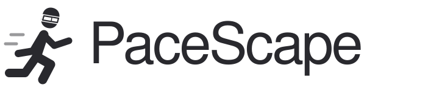

<div align="center">

  <picture>
    <source media="(prefers-color-scheme: dark)" srcset="docs/assets/pacescape-logo-dark.svg">
    
  </picture>

  <h3>Lauftraining trifft Augmented Reality.</h3>
  <p>PaceScape · Die Unity-App für Lauftraining mit der Magic Leap 2.</p>

  
  
  
  

  <br><br>
  <a href="#die-idee">Die Idee</a> &nbsp;·&nbsp;
  <a href="#entwicklungsstand">Entwicklungsstand</a> &nbsp;·&nbsp;
  <a href="#schnellstart">Schnellstart</a> &nbsp;·&nbsp;
  <a href="#server--dashboard">Server &amp; Dashboard</a> &nbsp;·&nbsp;
  <a href="docs/tracking-setup.md">Dokumentation</a> &nbsp;·&nbsp;
  <a href="https://github.com/kaanguen/PaceScapeControll">Server-Repository</a>

</div>

---

## Die Idee

**PaceScape** soll virtuelle Trainingsinhalte mit deiner realen Umgebung verbinden – für das Laufen auf dem **Laufband** und im **Stadion** mit der Magic Leap 2.

| 🛤️ Virtuelle Strecke | 🏃 Virtueller Laufpartner | 📊 Training im Blick |
| :---: | :---: | :---: |
| Eine Laufstrecke direkt im Sichtfeld. | Ein animierter Begleiter für dein Training. | Live-Laufdaten und Steuerung über ein Web-Dashboard. |

## Entwicklungsstand

**Die AR-Grundlage entsteht. Die Trainingsfunktionen folgen.**

- **Implementiert:** Unity/OpenXR-Grundgerüst, AprilTag-36H11-Erkennung, Ebenenerkennung und lokale räumliche Anker zur gemeinsamen Platzierung von Markerobjekt und ovaler Laufstrecke mit acht Spuren; ein animierter Jogger mit vorhandener Starter-Assets-Laufanimation und einstellbarer Pace (Standard 6:00 min/km) und Spurwahl.
- **In Prüfung:** Zuverlässige Erkennung und Platzierung auf der Magic Leap 2. Die vollständige Geräteprüfung steht noch aus.
- **Neu implementiert, noch auf der Brille zu prüfen:** Lokaler WebSocket-Server mit Steuerungswebsite für Pace, Startposition und Tracking; Einrichtung siehe [Remote Control](docs/remote-control.md).
- **Neu implementiert, noch zu prüfen:** Bluetooth-Anbindung für FTMS-Laufbänder: gemeldete Geschwindigkeit steuert den virtuellen Läufer; Suche und Geräteauswahl im Dashboard. [Einrichtung und Grenzen](docs/treadmill.md).

## Server & Dashboard

**[PaceScape Control](https://github.com/kaanguen/PaceScapeControll)** ist das separate Server-Projekt zur Steuerung der App. Das Dashboard läuft lokal am Rechner und verbindet sich über **WebSockets** mit PaceScape auf der Magic Leap 2.

- **Ghost:** Voreingestellte Geschwindigkeit oder Tempoverlauf eines gespeicherten Allzeit-PRs. Nach dessen Distanz wechselt der Ghost zu längeren vorhandenen PRs; ohne weiteren PR hält er sein letztes Tempo. Alte Rekorde ohne Verlauf nutzen ihre Durchschnittspace. Deine Laufbandmessung bestimmt deine Strecke, Runden und Bestzeiten unabhängig vom Ghost. [Einrichtung](docs/ghost-comparison.md).
- **Side by Side:** Der Begleiter bleibt neben dem kalibrierten Laufband und passt seine Laufanimation an die gemeldete Bandgeschwindigkeit an. Die Auswahl ist über das Unity-WebSocket-Protokoll verfügbar. [Einrichtung](docs/ghost-comparison.md#side-by-side)
- **Laufbandansicht:** Die virtuelle Bahn zieht im gemessenen Bandtempo unter dem kalibrierten Laufbandplatz nach hinten. Ein Ghost mit eigenem Tempo erscheint je nach Abstand vor oder hinter dir. Die Bewegung lässt sich in der **Ghost-Vorschau (Testdaten)** im Unity-Editor ausprobieren.
- **Pace:** Zieltempo live für bereits platzierte und neue Objekte einstellen.
- **Läufer einstellen:** Pace, Spur 1–8 und Startabstand gemeinsam übernehmen. Wartende Läufer werden direkt an die eingestellte Startposition gesetzt.
- **Lauf:** Der platzierte Läufer wartet auf „Lauf starten“. Pause hält seine Position; Weiterlaufen setzt den Lauf fort. Zurücksetzen beendet den Lauf und stellt die Startposition wieder her.
- **Tracking:** Erkennung starten, stoppen oder neu platzieren sowie Marker- und Bodeneinstellungen anpassen.
- **Status:** Trackingphase, platzierte und wartende Marker sowie App-Meldungen im Dark-Mode-Dashboard sehen.

## Schnellstart

### Unity-Projekt öffnen

Öffne den Unterordner `PaceScape/` in Unity Hub mit **Unity 2022.3.62f3**. Die Tracking-Szene liegt unter `Assets/Scenes/MarkerTrackingScene.unity`.

Für einen visuellen Test mit simuliertem Laufbandtempo öffne außerhalb des Play Mode **PaceScape → Ghost-Vorschau (Testdaten)**. Dort kannst du den PR-Ghost und **Side by Side** ausprobieren.

### Dashboard starten

Im Server-Repository mit **Node.js 22 oder neuer** starten:

```sh
npm ci
npm start
```

Danach **[localhost:8787](http://localhost:8787)** im Browser öffnen. Für die USB-Verbindung zur Brille bei verfügbarem ADB die Weiterleitung setzen:

```sh
adb reverse tcp:8787 tcp:8787
```

Die Erkennung startet mit der App; der platzierte Läufer bewegt sich erst nach dem Startbefehl im Dashboard. Die Pace bleibt im Lauf veränderbar; für eine andere Spur oder Startposition zuerst zurücksetzen. Tracking- oder Serververbindungsverlust pausiert einen laufenden Lauf; nach Wiederherstellung bewusst „Weiterlaufen“ wählen.

**Serveradresse im Unity Editor ändern:** Menü **PaceScape → Serververbindung** öffnen, **Rechner-IP übernehmen** wählen oder die WebSocket-Adresse eintragen und anschließend **Im Projekt speichern** wählen. Der IP-Button ist für einen Server auf demselben Rechner; bei mehreren Adaptern das Netz der Brille auswählen. Im Play Mode übernimmt **Speichern & neu verbinden** die Änderung direkt; für die Brille ist ein neuer Build nötig. Eine vorhandene Verbindungsdatei auf der Brille hat Vorrang.

Die aktualisierte App verbindet sich standardmäßig mit `ws://127.0.0.1:8787/ws`. Die vollständige USB-/WLAN-Einrichtung steht in der [Remote-Control-Anleitung](docs/remote-control.md). Ein neuer App-Build und die Prüfung auf der echten Brille sind noch erforderlich; Server und Dashboard wurden bislang mit einer gekennzeichneten Test-Brille geprüft. FTMS-Laufbandgeschwindigkeit und optionale Gesamtdistanz sind implementiert, aber noch nicht am Gerät geprüft; siehe [Laufband-Anbindung](docs/treadmill.md).

---

<p align="center">
  <a href="docs/tracking-setup.md">Technische Dokumentation</a> &nbsp;·&nbsp;
  <a href="https://github.com/kaanguen/PaceScapeControll">Server-Repository</a> &nbsp;·&nbsp;
  <a href="DISCLAIMER.md">Hinweise für Gerätetests</a> &nbsp;·&nbsp;
  <a href="THIRD-PARTY-NOTICES.md">Drittanbieter &amp; Lizenzhinweise</a>
</p>
